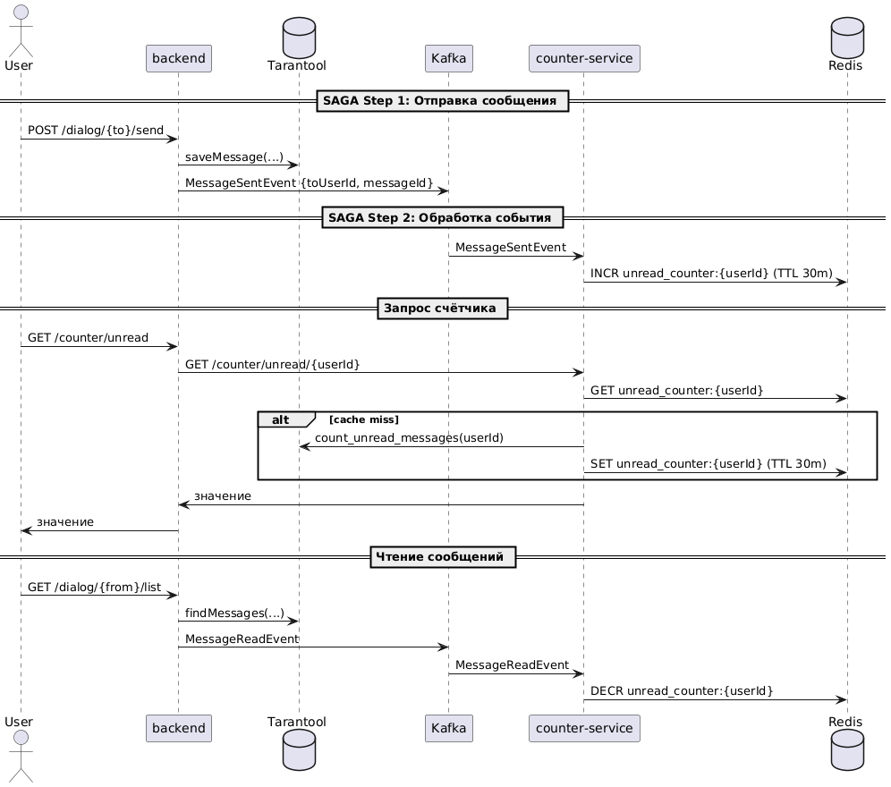

# Сервис счетчиков (`counter-service`)

# Цель

Реализовать отдельный микросервис `counter-service`, отвечающий за хранение счётчиков (например, количества непрочитанных сообщений), с учётом высокой нагрузки на чтение и требования консистентности. В качестве паттерна обеспечения согласованности выбран подход **Choreography-based Saga**.

---

# Архитектура

# Компоненты системы

backend - обрабатывает бизнес-логику, сохраняет сообщения в Tarantool  
counter-service - обслуживает только запросы количества непрочитанных сообщений
Kafka - передаёт события между сервисами без tight-coupling
Redis - хранит значения счётчиков с TTL для быстрого доступа
Tarantool - источник правды для пересчёта (при invalidate)             

## Общая схема:



## Особенности реализации
- `counter-service` реализован как отдельный Spring Boot сервис.
- Все счётчики хранятся в Redis по ключам вида unread_counter:{userId}, с TTL 30 минут.
- При отсутствии значения в Redis происходит invalidate — пересчёт из Tarantool.
- Все события (MESSAGE_SENT, MESSAGE_READ) поступают через Kafka и обрабатываются listener'ом.
- `backend` не взаимодействует с Redis напрямую — запросы идут через Feign-клиент к counter-service.

## Обеспечение консистентности (SAGA)
Используется Choreography-based Saga:
- `backend` сохраняет сообщение и публикует событие;
- `counter-service` независимо реагирует на событие;
- Нет централизованного оркестратора → choreography-based saga.
- отказ Kafka listener компенсируется fallback'ом через invalidate.

## Поток обработки

### При отправке нового сообщения:
* Пользователь вызывает POST /dialog/send.
* backend сохраняет сообщение в Tarantool.
* После успешной транзакции публикует событие MESSAGE_SENT в Kafka.
* counter-service слушает dialog-events топик.
* На событие MESSAGE_SENT → делает INCR в Redis.

### Получение количества непрочитанных сообщений:
* Пользователь вызывает GET /counter/unread в backend.
* backend идёт через Feign-клиент в counter-service.
* counter-service читает из Redis:
  * Если значение есть — отдаёт сразу.
  * Если нет — invalidate:
    * идёт в Tarantool, пересчитывает
    * пишет в Redis (с TTL 30 минут),
    * отдаёт результат.

## Механизмы инвалидации:
Поддерживаются 2 механизма:
 * TTL (30 минут): значение в Redis протухает → вынуждает пересчитать.
 * ручная инвалидация через POST /counter/unread/{userId}/invalidate;
 * пересчёт из Tarantool при null в Redis (например, редис был недоступен).

Инвалидация позволит восстановить консистентность даже если:
* Redis упал и потерял данные.
* Kafka consumer отвалился и не обновил счетчик.
* Баг или rollback оставил неконсистентное состояние.

## Про высокие нагрузки:
Почему это выдержит высокую нагрузку на чтение:
* Основная нагрузка — это GET /counter/unread в сервисе `counter-service`.
* Redis хорошо справляется с высокими нагрузками и подходит для чтений с QPS в тысячи запросов в секунду.
* Пишется мало (только на события) → нагрузка на Redis сбалансированная.
* Основные пересчёты из Tarantool происходят только при инвалидации.

В реальности, где то:
99% запросов от UI → кэш Redis.
1% → invalidate и пересчёт.

## Обаснвоание почему это подходит для MSA архитектуры:
* Чёткое разделение ответственности:
    * backend — это бизнес-логика, хранение сообщений.
    * counter-service — только счётчики.
* Достгается loose coupling через Kafka.
* Можно независимо масштабировать counter-service и Redis.
* Можно заменить Redis на другой хранилище без ломки контрактов.

# Инструкция по запуску

## 1.1 Сборка проекта монолита
```bash
mvn -f ../backend/pom.xml clean package -Dmaven.test.skip=true && \
docker build --no-cache --build-arg CONFIG_FILE=application-counter.yaml -t zsalamandra/z-social-network-hw10 -f ../backend/Dockerfile ../backend  
```

## 1.2 Сборка проекта сервиса счетчиков
```shell
mvn -f ../counter-service/pom.xml clean package -Dmaven.test.skip=true && \
docker build --no-cache --build-arg CONFIG_FILE=application.yaml -t zsalamandra/z-social-network-counter-hw10 -f ../counter-service/Dockerfile ../counter-service
```

## 2 Запуск проекта
```shell
docker compose up -d z-social-network-hw10-app
```

5. Очистки
```bash
docker ps -q --filter "name=z-social-network*" | xargs -r docker stop && \
docker ps -aq --filter "name=z-social-network*" | xargs -r docker rm && \
docker images | grep "^zsalamandra/" | awk '{print $3}' | xargs -r docker rmi && \
docker network ls --filter "name=social-network$" -q | xargs -r docker network rm && \
docker volume ls -qf dangling=true | xargs -r docker volume rm
```