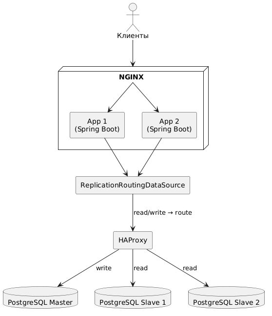

# Отказоустойчивость приложений (HA)

## Цель

Реализовать отказоустойчивую архитектуру с балансировкой нагрузки как для backend-приложений, так и для подключений к базе данных.

## Архитектура

### Компоненты:
- **HAProxy** — проксирует подключения к нескольким слейвам PostgreSQL.
- **NGINX** — балансирует входящий трафик между несколькими инстансами backend-приложения.
- **PostgreSQL** — используется 1 мастер и 2 слейва.
- **Spring Boot-приложение** — развёрнуто в двух инстансах (App1 и App2).

### Схема


## Балансировка PostgreSQL через HAProxy

- Используется режим tcp для проксирования PostgreSQL.
- Задействовано 2 слейва, подключение идет к HAProxy по адресу haproxy:5432.
- Чтение из БД идёт через slave datasource с маршрутизацией на уровне ReplicationRoutingDataSource.

## Балансировка приложений через NGINX

- Балансировка по round-robin.
- В конфигурации NGINX добавлена секция `upstream backend`, где указаны оба контейнера приложения.
- Sticky session не используется

## Эксперименты на отказоустойчивость

### Отключение слейва PostgreSQL

- Под нагрузкой выполняется остановка одного из контейнеров PostgreSQL slave.
- Через HAProxy продолжается чтение с оставшихся слейвов.
- Приложение продолжает функционировать.

### Отключение backend-инстанса

- Выполнен останов одного из backend-инстансов.
- NGINX перенаправляет трафик на оставшийся инстанс.
- Система остаётся работоспособной.

## Вывод

Архитектура позволяет пережить падение одного из слейвов БД или backend-инстанса без потери доступности для пользователей.


# Проверки

## 1. Билдим проект и готовим образ
```bash
mvn -f ../backend/pom.xml clean package -Dmaven.test.skip=true && \
docker build --no-cache --build-arg CONFIG_FILE=application-ha.yaml -t zsalamandra/z-social-network-hw9 -f ../backend/Dockerfile ../backend  
```

## 2. Запуск проекта (без слейвов)
```shell
docker-compose up -d z-postgres-master z-social-network-hw9-nginx
```

## 3. Делаем бекап мастера в директории для слейвов
```shell
mkdir -p "backup" &&
docker exec -it z-social-network-hw9-postgres-master bash -c "pg_basebackup -h z-social-network-hw9-postgres-master -D /tmp -U replicator -v -P --wal-method=stream" &&
touch ./backup/standby.signal &&
mkdir -p ./slave-1/postgres-data && cp -r ./backup/* ./slave-1/postgres-data/ &&
mkdir -p ./slave-2/postgres-data && cp -r ./backup/* ./slave-2/postgres-data/
```

## 4. Запуск слейвов
```shell
docker-compose up -d z-postgres-slave-1 z-postgres-slave-2
```

Проверка HA осуществляется отпарвкой пачки запросов на чтение данных пользователя
на url /user/get/{user-id}. Кол-во отправляемых запросов 40 - равно кол-ву юзеров занесенных в БД.
Так как haproxy стоит только перед слейвами, запросы на сохранение не отправляю. Из мастера в
слейвы настроена асинхронная репликация, промоутинг до мастера не реализован.

## 5 Проверка резервирования приложения
Запускаем град запросов на чтение, через nginx, когда доходим до 15 по счету запроса, 
останавливаем указанный в парамерах контейнер,
ожидание - ответы на запросы должны продолжать получать
```bash
sh ./testplan/test-loop.sh z-social-network-hw9-app-1
```
## 5.1 Запуск остановленного ранее контейнера
```bash
docker-compose up -d z-social-network-hw9-app-1
```

## 5 Проверка резервирования слейва БД
Запускаем град запросов на чтение, через nginx, когда доходим до 15 по счету запроса,
останавливаем указанный в парамерах контейнер,
ожидание - ответы на запросы должны продолжать получать
```bash
sh ./testplan/test-loop.sh z-social-network-hw9-postgres-slave-2
```

5. Очистки
```bash
docker ps -q --filter "name=z-social-network*" | xargs -r docker stop && \
docker ps -aq --filter "name=z-social-network*" | xargs -r docker rm && \
docker images | grep "^zsalamandra/" | awk '{print $3}' | xargs -r docker rmi && \
docker network ls --filter "name=social-network$" -q | xargs -r docker network rm && \
docker volume ls -qf dangling=true | xargs -r docker volume rm
```