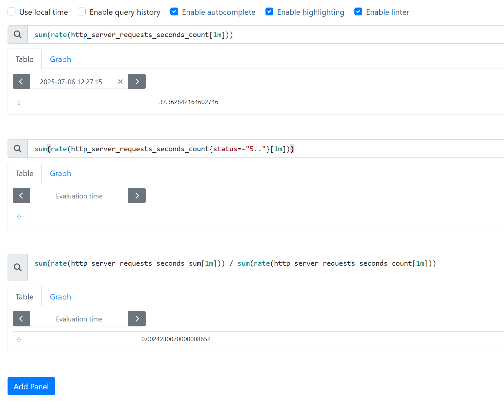
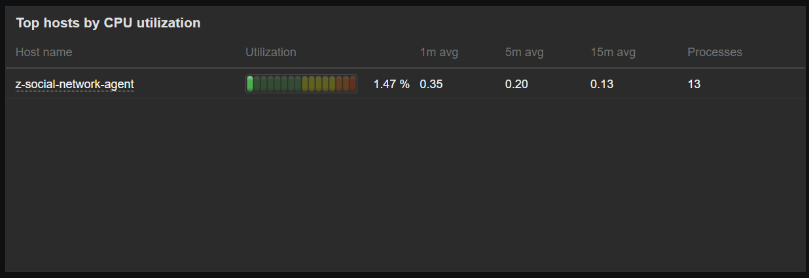
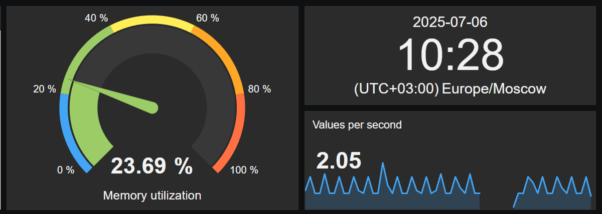
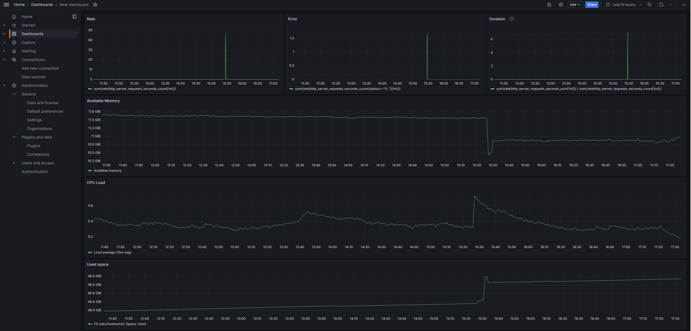

# Сервис счетчиков (`counter-service`)

# Цель

Организовать мониторинг сервиса чатов

---

# Архитектура

## Общие сведения
Мониторинг построен по принципу разделения ответственности:

**Prometheus** — сбор и хранение бизнес-метрик сервиса по принципу RED.
**Zabbix** — сбор технических метрик сервера и контейнеров.
**Grafana** — единая точка визуализации данных из обоих источников.

## Инфраструктура

В единой сети подняты контейнеры:
* сервис приложения (Spring Boot)
* Prometheus
* Grafana
* Zabbix Server
* Zabbix Frontend
* Zabbix Agent
* PostgreSQL для хранения данных Zabbix

### Prometheus

Подключен к сервису через endpoint /actuator/prometheus.

Сбор бизнес-метрик (RED-модель):
* частота запросов
* ошибки (5xx)
* время отклика

Конфигурация scrape настроена в prometheus.yml.
```yaml
global:
  scrape_interval: 15s
scrape_configs:
  - job_name: 'spring-boot'
    metrics_path: '/actuator/prometheus'
    static_configs:
      - targets: ['z-social-network-hw11-app:8085']
```
#### Скрины:



### Zabbix

Поднят сервер (zabbix-server) и агент (zabbix-agent) в отдельных контейнерах.

Агент собирает технические метрики хоста:
* CPU
* RAM
* Диск

Используован стандартный шаблон «Linux Zabbix agent».
База данных Zabbix развернута на отдельном контейнере с PostgreSQL.
И поднят отдельный zabbix-frontend для управления и конфигурации через UI.

#### Скрины:



### Grafana

Подключены два Data Source:
* Prometheus (для бизнес-метрик)
* Zabbix (для технических метрик)

Создан единый дашборд с секциями:
RED-метрики из Prometheus
Системные метрики из Zabbix

#### Скрины:



## Заключения

В результате архитектура мониторинга выглядит как интеграция двух подходов:

* **Prometheus** - time-series и бизнес-метрики сервиса.
* **Zabbix** - инфраструктурный маниторинг с агентом.
* **Grafana** это унифицированный дашборд для просмотра состояния системы.


# Инструкция по запуску

## 1 Сборка проекта
```shell
mvn -f ../backend/pom.xml clean package -Dmaven.test.skip=true && \
docker build --no-cache --build-arg CONFIG_FILE=application-counter.yaml -t zsalamandra/z-social-network-hw11 -f ../backend/Dockerfile ../backend && \
mvn -f ../counter-service/pom.xml clean package -Dmaven.test.skip=true && \
docker build --no-cache --build-arg CONFIG_FILE=application.yaml -t zsalamandra/z-social-network-counter-hw11 -f ../counter-service/Dockerfile ../counter-service  
```


## 2 Запуск проекта
```shell
docker compose up -d z-social-network-hw11-app
```

5. Очистки
```bash
docker ps -q --filter "name=z-social-network*" | xargs -r docker stop && \
docker ps -aq --filter "name=z-social-network*" | xargs -r docker rm && \
docker images | grep "^zsalamandra/" | awk '{print $3}' | xargs -r docker rmi && \
docker network ls --filter "name=social-network$" -q | xargs -r docker network rm && \
docker volume ls -qf dangling=true | xargs -r docker volume rm
```